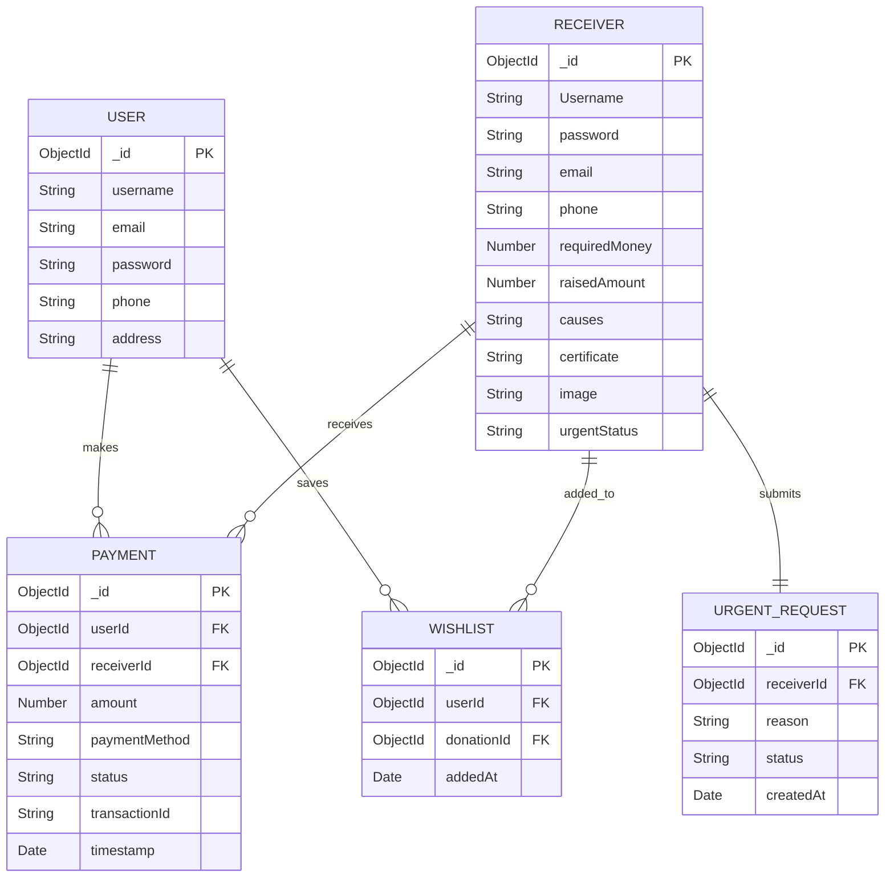

# 🏦 HopeBank — Crowdfunding & Donation Platform

[](https://nodejs.org/)
[](https://expressjs.com/)
[](https://www.mongodb.com/)
[](https://ejs.co/)
[](https://opensource.org/licenses/ISC)

HopeBank is a modern, transparent, and robust peer-to-peer crowdfunding platform built on Node.js, Express, and MongoDB. It bridges the gap between donors and receivers across various causes like medical emergencies, education, animal welfare, and community initiatives. 

The platform supports role-based access for Donors, Receivers, and Admins, complete with simulated payments, verification document uploads, wishlist tracking, and automated background tasks to maintain platform cleanliness.

---

## 📂 Project Structure

A clean, organized directory layout following the MVC (Model-View-Controller) architecture pattern:

```text
Hopebank/
├── ⚙️ config/
│   └── db.js                        # Database connection setup using Mongoose
├── 📦 model/                        # Mongoose Schemas & Database Models
│   ├── payment.model.js             # Tracks simulated donor transactions
│   ├── receiver.model.js            # Recipient details, targets, and verified documents
│   ├── requestUrgent.model.js       # Handles urgent verification requests by receivers
│   ├── user.model.js                # Core profile for Donors/Users
│   └── wishlist.model.js            # Saved campaigns per donor
├── 📁 public/                       # Static assets served by Express
│   ├── imager/                      # Static images & icons
│   ├── javascript/                  # Client-side form validation and interactive logic
│   │   ├── login.js
│   │   ├── loginr.js
│   │   ├── script.js
│   │   ├── signd.js
│   │   └── signr.js
│   ├── stylesheet/                  # Core application designs
│   │   ├── login.css
│   │   ├── receiver.css
│   │   └── style.css
│   └── uploads/                     # Uploaded recipient images and certificates (Multer destination)
├── 🛣️ routes/                        # Server routing and middleware handling
│   ├── admin.route.js               # Admin dashboard and urgent request approval logic
│   ├── forgot.route.js              # Password recovery flow (email resets) for users/receivers
│   ├── receiver.route.js            # Receiver registrations, file uploads, and dashboard settings
│   └── user.route.js                # General site navigation, Donor registrations, and payment routes
├── 🛠️ utils/                        # Auxiliary helper functions
│   └── autoDelete.js                # Automated background script for completed campaigns
├── 🪟 views/                        # Dynamic frontend pages (Embedded JS templates)
│   ├── about.ejs                    # Platform vision and about page
│   ├── index.ejs                    # Homepage featuring urgent/verified cases
│   ├── login.ejs / loginr.ejs       # Auth entry points for Donors / Receivers
│   ├── signd.ejs / signr.ejs        # Registrations for Donors / Receivers
│   ├── dashboard.ejs                # Admin metrics pane
│   ├── payment.ejs                  # Simulated payment checkout
│   ├── profile.ejs / receiver_home  # Client-specific dashboards
│   └── urgent-requests.ejs          # Admin request moderation panel
├── 📄 app.js                        # Main application entry point and middleware config
├── 📄 package.json                  # Dependencies and execution scripts
└── 📄 .gitignore                    # Prevents node_modules and .env check-ins
```

---

## ⚡ Key Features

### 👤 1. Donor (User) Features
* **Custom Registration & Login**: Interactive forms with client & server-side validation using `express-validator`.
* **Category Filtering**: Explore campaigns classified under **Medical, Education, Animal, NGOs, Children/Elderly**, and **Other**.
* **Personal Wishlist**: Pin specific recipient campaigns to track their progress and fund later.
* **Simulated Checkout System**: Support Card, UPI, and Netbanking payments to fund recipients directly.
* **Donation History**: Track all donations made by the logged-in donor account.
* **Security & Auth**: Secured sessions using JSON Web Tokens (JWT) signed and packaged into secure HTTP cookies.

### 🏥 2. Receiver (Recipient) Features
* **Verification Uploads**: Secure document and profile image uploading powered by `multer`.
* **Funding Campaigns**: Define goal target amount (`requiredMoney`), track `raisedAmount`, and describe the cause.
* **Urgent Funding Requests**: Mark a campaign as "Urgent" to place it on the homepage carousel once approved by the administrator.
* **Password Reset Flow**: Request secure password recovery via email notifications powered by `nodemailer`.

### 🔑 3. Administrator Features
* **Overview Analytics**: View aggregated counts of users, receivers, and transactions alongside total donations processed.
* **Campaign Auditing**: Review uploaded medical or legal certificates before approving recipient requests.
* **Urgent Request Moderation**: Approve or decline "Urgent Status" promotion requests in real-time.

### 🤖 4. Background Automation (`autoDelete.js`)
* **Real-time Target Tracking**: Runs a lightweight background interval to scan active campaigns.
* **Graceful Archiving**: Once a receiver reaches their required financial target:
  1. Safely locks all related payments status to `success` and registers completion notes.
  2. Clears related entries from donor wishlists.
  3. Automatically archives/deletes the receiver profile from active directories to keep lists clean.

---

## 💾 Database Schema Overview



---

## 🌐 API Route Reference

### General & Donor Routes (`routes/user.route.js`)
| Method | Endpoint | Description | Auth Required |
|:---|:---|:---|:---|
| **GET** | `/` | Renders homepage with urgent verified cases | No |
| **GET** | `/select` | Choose role: Sign up as Donor or Receiver | No |
| **POST** | `/signd` | Processes donor registration | No |
| **POST** | `/logind` | Authenticates donor and issues JWT cookie | No |
| **GET** | `/profile` | Shows donor dashboard & donation history | Yes (Donor) |
| **GET** | `/wishlist` | Shows donor's saved campaigns | Yes (Donor) |
| **POST** | `/wishlist/add/:receiverId` | Adds a receiver to donor wishlist | Yes (Donor) |
| **POST** | `/payment/:receiverId` | Process simulated payment for a campaign | Yes (Donor) |

### Recipient Routes (`routes/receiver.route.js`)
| Method | Endpoint | Description | Auth Required |
|:---|:---|:---|:---|
| **POST** | `/upload` | Registers receiver with certificate & image files | No |
| **POST** | `/loginr` | Authenticates receiver and issues JWT cookie | No |
| **GET** | `/receiver/dashboard` | Renders receiver's funding overview & stats | Yes (Receiver) |
| **POST** | `/receiver/request-urgent` | Request "Urgent Status" from admin | Yes (Receiver) |

### Admin Routes (`routes/admin.route.js`)
| Method | Endpoint | Description | Auth Required |
|:---|:---|:---|:---|
| **GET** | `/admin/dashboard` | View metrics, total funds raised, and transactions | Yes (Admin) |
| **GET** | `/admin/urgent-requests` | Manage and review pending urgent tags | Yes (Admin) |
| **POST** | `/admin/urgent-requests/:requestId/:action` | Approve/reject a recipient's urgent appeal | Yes (Admin) |

---

## 🛠️ Installation & Setup

### Prerequisites
* [Node.js](https://nodejs.org/) (version 18 or higher recommended)
* [MongoDB](https://www.mongodb.com/try/download/community) local instance or a [MongoDB Atlas](https://www.mongodb.com/cloud/atlas) cloud URI.

### Step 1: Clone the Repository
```bash
git clone https://github.com/DhruvilTech/Hopebank.git
cd Hopebank
```

### Step 2: Install Dependencies
```bash
npm install
```

### Step 3: Configure Environment Variables
Create a file named `.env` in the root of the project:
```env
# Application Configurations
PORT=3000
NODE_ENV=development

# Database Settings
MONGODB_URI=mongodb://localhost:27015/hopebank   # Replace with your MongoDB Connection string

# Cryptography Secrets
JWT_SECRET=your_super_secure_jwt_secret_key      # Replace with a strong key for session security
```

### Step 4: Launch the Server
**Start development/production server:**
```bash
npm start
```
The console will log `Connected to MongoDB successfully` and `Server is running on port 3000`. Navigate to `http://localhost:3000` in your web browser.

---

## 🔒 Security & Best Practice Recommendations

To take this application to a production-ready standard, consider implementing the following:

1. **Move SMTP Configuration to Environment Variables**:
   In `routes/forgot.route.js`, the Nodemailer sender credentials are currently hardcoded. Modify this to use environment variables for security:
   ```js
   const transporter = nodemailer.createTransport({
       service: 'gmail',
       auth: {
           user: process.env.SMTP_EMAIL,
           pass: process.env.SMTP_PASSWORD
       }
   });
   ```
2. **Setup File Cleanup for Rejected/Completed Campaign Uploads**:
   When the background worker deletes completed receivers, ensure related file uploads (`public/uploads/...`) are deleted from the disk using Node's `fs` module to save storage space.
3. **Session Expiry**:
   Keep JWT cookie expiry aligned with token validation durations to avoid orphaned login sessions.
